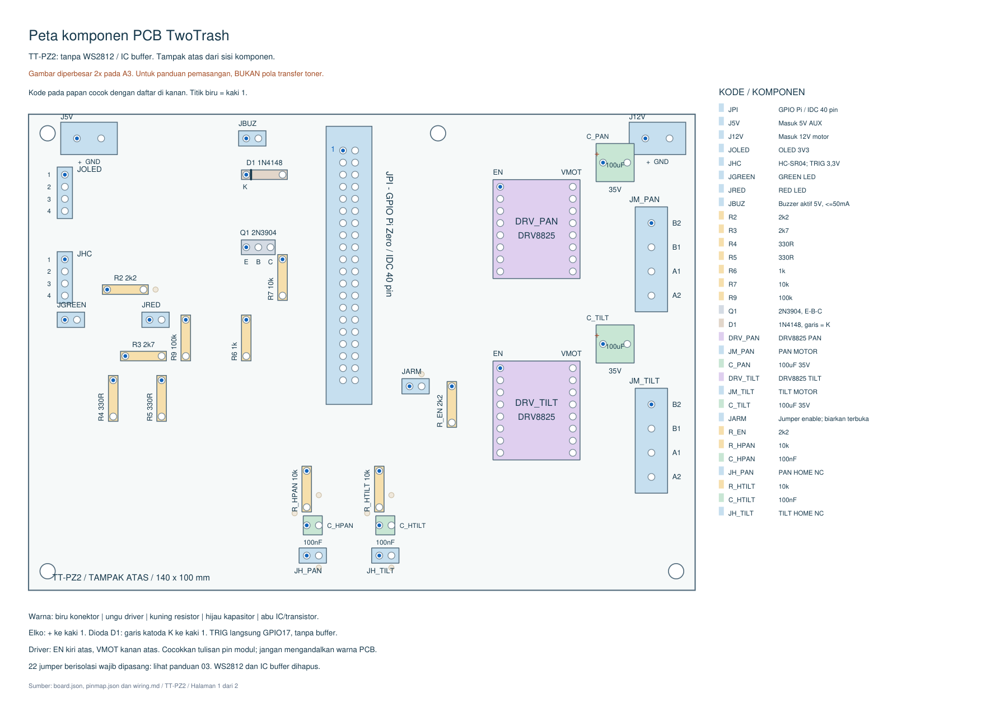

# Wiring TT-PZ2: Pi Zero langsung ke dua NEMA17

Revisi 26 Oktober 2026. Mekanik: [Rev G1, flap 200 × 250 mm, flap kosong](3d/external-gears/CATATAN.txt).
**Tidak memakai Arduino Nano.** Pi Zero mengendalikan dua modul **DRV8825**, masing-masing untuk motor **42HD4027-01, 1,5 A/fase**. Kamera lama diganti webcam USB. **TT-PZ2 menghapus WS2812 dan IC buffer; TRIG HC-SR04 langsung dari Pi 3,3 V.** Pola dan jumper telah dirutekan ulang: gunakan semua file TT-PZ2 bersama, jangan mencampur pola TT-PZ1.

**Status:** pola PCB satu sisi dibuat untuk prototipe. Program dalam proyek masih mengendalikan servo; belum menghasilkan gerak stepper, homing, atau penanganan FAULT sesuai tabel di bawah. Jangan menjalankan urutan sortir lama pada rakitan baru. Biarkan jumper **JARM terbuka** sampai perangkat lunak stepper siap.

## File PCB

Semua sumber, pemeriksaan dan keluaran ada di [pcb/](pcb/).

- [01-transfer-toner-1to1.pdf](pcb/output/pdf/01-transfer-toner-1to1.pdf): **file yang dicetak untuk transfer toner**. Hitam adalah tembaga yang dipertahankan.
- [02-tembaga-bawah-inspeksi.pdf](pcb/output/pdf/02-tembaga-bawah-inspeksi.pdf): tampilan sisi tembaga setelah transfer; untuk pembanding, bukan master transfer kedua.
- [03-komponen-dan-bor.pdf](pcb/output/pdf/03-komponen-dan-bor.pdf): posisi komponen tampak atas dan panduan bor.
- [04-peta-komponen-jelas.pdf](pcb/output/pdf/04-peta-komponen-jelas.pdf): peta berwarna diperbesar 2× pada A3, kode/nilai 31 komponen, polaritas, dan tabel pin konektor. Untuk membaca pemasangan, bukan transfer toner.
- [Daftar jumper kawat](pcb/jumpers.csv), [BOM](pcb/bom.csv), [daftar kaki/net](pcb/pads.csv), dan [hasil pemeriksaan](pcb/drc-report.json).

Papan **140 × 100 mm**, FR4 satu sisi, tembaga nominal **35 µm / 1 oz**. Komponen berada di sisi tanpa tembaga. Modul driver memakai soket. Soket driver setinggi minimal 8,5 mm menyediakan ruang jumper di bawah modul. Pi berada di luar PCB, dihubungkan dengan kabel IDC 40 pin **1-ke-1**, pendek sekitar 10–15 cm; pin 1 wajib bertemu pin 1. PCB ini menggantikan papan lubang lama, bukan pola untuk PCB lubang 2 × 8 cm.

## Daya dan kamera

| Sambungan | Sumber / fungsi |
| --- | --- |
| Pi Zero | Catu USB 5 V yang sesuai Pi; tetap melalui port **PWR IN** |
| J12V-1 / -2 | +12 V / GND dari adaptor DC 12 V, kapasitas awal 3 A, melalui sekring eksternal 2 A |
| J5V-1 / -2 | +5 V AUX / GND dari catu stabil 5 V 2 A; melalui sekring eksternal 1,5 A |
| Webcam | Kabel USB ke port **USB/OTG** Pi melalui adaptor OTG; bukan PWR IN |

Pin 5 V Pi (pin fisik 2 dan 4) **tidak dirutekan** ke 5 V AUX. Semua ground bertemu di PCB. Tegangan 12 V tidak masuk ke Pi, OLED, atau sensor. Dua motor mendapat daya hanya dari keluaran DRV8825; tegangan nominal lilitan motor bukan tegangan adaptor yang harus dipakai ketika menggunakan pembatas arus driver.

Kamera menggunakan kabel USB utuh; pasangan D+/D− tidak dibuat di PCB etsa ini. Jika perangkat USB tambahan diperlukan, gunakan hub USB yang sesuai dan tidak memberi daya balik ke port upstream. Lebar pandangan ditentukan lensa webcam, bukan rangkaian PCB. Posisi rencana lensa sekitar 30 cm dari flap; uji seluruh area flap terlihat sebelum mengencangkan dudukan.

PCB hanya membawa tegangan DC rendah. Adaptor, sekring dan sambungan jaringan listrik tetap di luar papan ini. Jangan memindahkan terminal PLN lama ke pola PCB ini.

## Koneksi Pi

Nomor BCM dan nomor fisik **berbeda**. Semua nomor pada konektor JPI mengikuti nomor fisik header Pi 40 pin. Kaki JPI yang tidak disebutkan pada tabel tidak dirutekan.

| Fungsi | BCM | Pin fisik / JPI | Ke |
| --- | ---: | ---: | --- |
| 3,3 V | — | 1 | OLED, logika driver, pull-up home dan enable |
| Ground | — | 6 | GND bersama |
| OLED SDA | 2 | 3 | JOLED-4 |
| OLED SCL | 3 | 5 | JOLED-3 |
| HC-SR04 TRIG | 17 | 11 | Langsung ke JHC-2, sinyal 3,3 V |
| HC-SR04 ECHO | 27 | 13 | Pembagi R2/R3 dari JHC-3 |
| LED hijau | 22 | 15 | R4 330 Ω → JGREEN-1 |
| LED merah | 23 | 16 | R5 330 Ω → JRED-1 |
| Buzzer | 5 | 29 | R6 → transistor Q1 → JBUZ-2 |
| PAN STEP | 18 | 12 | DRV_PAN STEP |
| PAN DIR | 12 | 32 | DRV_PAN DIR |
| TILT STEP | 13 | 33 | DRV_TILT STEP |
| TILT DIR | 19 | 35 | DRV_TILT DIR |
| ENABLE bersama | 26 | 37 | Lewat JARM ke kedua EN, **LOW = aktif** |
| Home pan | 6 | 31 | JH_PAN-1 |
| Home tilt | 16 | 36 | JH_TILT-1 |
| FAULT pan | 20 | 38 | DRV_PAN FAULT, **LOW = fault** |
| FAULT tilt | 25 | 22 | DRV_TILT FAULT, **LOW = fault** |

GPIO Pi menggunakan logika 3,3 V. GPIO21/pin40 (ring lama), GPIO24/pin18 dan koneksi servo lama tidak dipakai pada PCB ini. Jangan menjalankan modul `motor` L298N yang memakai pin bertumpang tindih. [Dokumentasi GPIO Raspberry Pi](https://www.raspberrypi.com/documentation/computers/raspberry-pi.html#gpio).

## Dua driver DRV8825

Footprint dikunci ke **pinout carrier Pololu 2133**, dua baris masing-masing 8 pin, pitch 2,54 mm, jarak antarbaris 15,24 mm. Modul dipasang komponen menghadap atas: **EN di kiri atas, VMOT di kanan atas** pada gambar penempatan. Cocokkan tulisan kaki pada modul yang dibeli; jangan menilai arah dari posisi trimpot atau warna PCB. A4988/TMC bukan pengganti tanpa pemeriksaan ulang.

| Baris kiri, atas → bawah | Net | Baris kanan, atas → bawah | Net |
| --- | --- | --- | --- |
| EN | ENABLE bersama | VMOT | +12 V |
| M0 | GND | GND | GND |
| M1 | GND | B2 | JM motor pin 1 |
| M2 | 3,3 V | B1 | JM motor pin 2 |
| RESET | 3,3 V | A1 | JM motor pin 3 |
| SLEEP | 3,3 V | A2 | JM motor pin 4 |
| STEP | GPIO sesuai sumbu | FAULT | GPIO FAULT masing-masing |
| DIR | GPIO sesuai sumbu | GND | GND |

Konfigurasi M0=0, M1=0, M2=1 memilih **1/16 microstep**. Dengan motor 200 langkah/putaran dan gear 3:1, satu putaran keluaran membutuhkan 9.600 pulsa; 1° sekitar 26,667 pulsa. Gunakan target posisi absolut dalam satuan langkah agar pembulatan sudut tidak terakumulasi. Input driver menerima 3,3 V; pembatas arus dan setelan langkah harus sesuai carrier. [Panduan carrier DRV8825](https://www.pololu.com/product/2133).

C_PAN dan C_TILT adalah elko **100 µF 35 V**, masing-masing dekat pasangan VMOT/GND. Kaki positif ke 12 V. Jangan mencabut/memasang motor atau driver saat diberi daya. EN ditarik HIGH oleh R_EN 2,2 kΩ; JARM yang terbuka memutus kontrol enable dari Pi. RESET/SLEEP ikut 3,3 V Pi sehingga driver tidak dibangunkan ketika Pi tidak diberi daya.

Terminal motor berurutan **B2, B1, A1, A2**. Cari dua pasangan lilitan memakai ohmmeter: satu pasangan ke B2/B1, pasangan lain ke A1/A2. Jangan mengandalkan warna kabel; kabel dalam satu pasangan menunjukkan resistansi kecil, pasangan silang tidak tersambung. Tukar kedua kabel satu pasangan hanya jika perlu membalik arah dan setelah daya dicabut.

**Setelan awal pembatas arus: 1,0 A.** Untuk carrier dengan resistor sense **R100 = 0,10 Ω**, rumusnya `I_limit = Vref / (5 × Rsense)`, sehingga Vref awal 0,50 V. Batas motor 1,5 A setara 0,75 V **hanya bila Rsense benar-benar 0,10 Ω**. Jangan memakai angka tersebut pada clone R050/R068 atau trimpot yang belum diketahui. Gunakan heatsink dan aliran udara; naikkan arus hanya setelah memeriksa suhu dan kebutuhan torsi. Pengukuran arus adaptor bukan pengukuran arus lilitan. [Datasheet TI DRV8825](https://www.ti.com/lit/ds/symlink/drv8825.pdf).

## Sensor, lampu dan buzzer

| Konektor | Urutan kaki 1 → terakhir |
| --- | --- |
| JOLED | GND, **3,3 V**, SCL, SDA |
| JHC | 5 V AUX, TRIG **3,3 V**, ECHO 5 V, GND |
| JGREEN / JRED | Anoda LED setelah resistor, katoda/GND |
| JBUZ | +5 V AUX, negatif buzzer ke kolektor Q1 |
| JH_PAN / JH_TILT | Input home, GND |

OLED harus modul yang mendukung suplai 3,3 V dan tidak memiliki pull-up I²C ke 5 V. Urutan soket modul OLED dapat berbeda dari JOLED; sambungkan berdasarkan nama sinyal.

TRIG pada JHC-2 terhubung **langsung ke GPIO17 / pin fisik 11**, dengan R9=100 kΩ ke GND. Pi memberi pulsa HIGH minimal 10 µs; beri jarak antarukur lebih dari 60 ms. HC-SR04 tetap mendapat daya 5 V. Datasheet menyebut masukan TRIG berupa pulsa TTL; penggunaan 3,3 V ini perlu diuji pada modul yang dibeli karena clone dapat berbeda. Jika tidak terpicu konsisten, periksa modul/kabel dan sesuaikan antarmuka; jangan memberi 5 V ke GPIO. [Datasheet HC-SR04](https://cdn.sparkfun.com/datasheets/Sensors/Proximity/HCSR04.pdf).

ECHO **tetap melalui pembagi tegangan** R2=2,2 kΩ dan R3=2,7 kΩ: `5 × 2,7 / (2,2 + 2,7) ≈ 2,76 V`. ECHO sensor tidak langsung masuk Pi.

U1, soket DIP14, JRING, R1, R8, C1 dan C2 telah dihapus. LED indikator merah/hijau, buzzer, OLED dan dua kapasitor filter home tetap digunakan. GPIO21/pin40 tidak dirutekan. Nomor referensi komponen lain dipertahankan agar mudah dibandingkan; tidak ada komponen yang perlu dipasang pada nomor yang dihapus.

Buzzer adalah **aktif 5 V, dua kaki, maksimum 50 mA**. Q1=2N3904 memakai urutan E-B-C sesuai [datasheet onsemi](https://www.onsemi.com/pdf/datasheet/2n3904-d.pdf); kaki dibentuk ke pitch 2,54 mm pada PCB. R6=1 kΩ, R7=10 kΩ untuk menahan basis LOW ketika GPIO belum aktif. Garis katoda D1 (1N4148) ke +5 V, anoda ke kolektor. Modul buzzer tiga kaki memerlukan sambungan berbeda; jangan menyambungnya hanya berdasarkan warna kabel.

Home memakai microswitch **COM dan NC**: keadaan belum tertekan menghubungkan input ke GND; ketika terkena mekanik atau kabel putus, input HIGH. R_H masing-masing 10 kΩ ke 3,3 V, C_H 100 nF ke GND. Firmware harus memperlakukan kabel putus sebagai kegagalan homing; dua switch ini bukan sertifikasi batas keselamatan mekanik.

## Cetak dan etsa

1. Buka **01-transfer-toner-1to1.pdf**. Cetak laser pada **Actual size / 100%**, A4, hitam penuh. Matikan Fit/Shrink dan **jangan mirror lagi**.
2. Ukur garis kalibrasi 50 mm dan jarak kaki 2,54/15,24 mm di kertas. Tempelkan modul/soket nyata pada gambar penempatan untuk memeriksa footprint sebelum etsa.
3. Letakkan sisi toner menghadap tembaga. Master sudah disiapkan untuk cara ini; setelah transfer, sisi tembaga harus sama dengan **02-tembaga-bawah-inspeksi.pdf**. Jangan memakai kedua file secara bergantian.
4. Setelah etsa, bor sesuai panduan: 1,0 mm untuk mayoritas kaki, 1,2 mm untuk terminal sekrup, 3,2 mm lubang dudukan. Titik putih kecil di pola adalah pusat bor, bukan ukuran akhir lubang. Pad bulat hitam penuh tanpa titik putih adalah test point cadangan: tidak perlu dibor.
5. Pasang **22 jumper W01–W22** dari `jumpers.csv` dengan kawat berisolasi; garis jumper pada gambar atas **bukan jalur tembaga**. Jumper yang berbeda boleh bersilangan hanya dalam isolasi. Sisakan ruang untuk memasang/melepas soket dan heatsink; panjang potong pada tabel adalah perkiraan awal, tambah bila jalur kawat perlu memutar.
6. Pasang resistor, diode, transistor, elko, terminal dan socket driver. Perhatikan polaritas elko, D1, Q1, orientasi driver. Bersihkan sisa etsa/flux sebelum uji.

Jalur minimum sinyal 0,6 mm, jalur utama yang lebih lebar 1,2–1,5 mm, jarak tembaga minimum rancangan 0,4 mm. Keluaran DRC digital tidak menggantikan inspeksi hasil etsa; lubang/solder yang melebar atau jalur tergerus dapat mengubah hasil.

## Urutan uji

1. Tanpa Pi, driver dan motor terpasang: ukur kontinuitas semua net; pastikan 12 V, 5 V AUX, 3,3 V dan GND tidak korslet. Periksa khusus celah antarpad header.
2. Uji catu di terminal dengan pembatas arus. Pastikan +12 V hanya ada di VMOT dan elko motor, +5 V AUX hanya di periferal 5 V. Cabut daya kembali sebelum memasang modul.
3. Pasang driver sesuai pinout, **JARM tetap dilepas**. Hentikan service servo lama. Nyalakan Pi dahulu, lalu 5 V AUX dan 12 V; ukur rel dan setel Vref dengan motor masih dilepas.
4. Cabut semua daya, hubungkan pasangan lilitan dan sensor. Nyalakan kembali. Uji kamera, OLED, pembacaan home dan FAULT tanpa mengaktifkan motor.
5. Setelah kontrol STEP/DIR tersedia, tetapkan STEP LOW, DIR sesuai arah, ENABLE HIGH; baru pasang JARM. Awali gerak lambat tanpa sampah. Pulsa STEP HIGH dan LOW harus memenuhi datasheet; target awal HIGH 5 µs, kecepatan motor sekitar 267 pulsa/detik untuk flap 10°/detik.
6. Gunakan generator pulsa bertiming perangkat keras/DMA, bukan loop `time.sleep()` Python untuk gerak produksi. Homing, batas sudut, ramp percepatan dan penghentian saat FAULT harus diimplementasikan sebelum sortir otomatis.
7. Periksa panas driver, jalur, konektor, kelancaran dan selip pinion. Putuskan catu AUX/motor sebelum mematikan atau melepas Pi. Flap tetap dinilai untuk **beban kosong**, bukan sampah 1 kg.

Kabel motor gunakan pasangan lilitan dipilin, sekitar 0,5 mm²; 12 V dan return utama 0,75 mm². Pisahkan kabel motor dari USB, sensor dan I²C. Jaga kabel TRIG/ECHO tetap pendek dan uji pembacaan HC-SR04 pada panjang kabel pemasangan sebenarnya.
