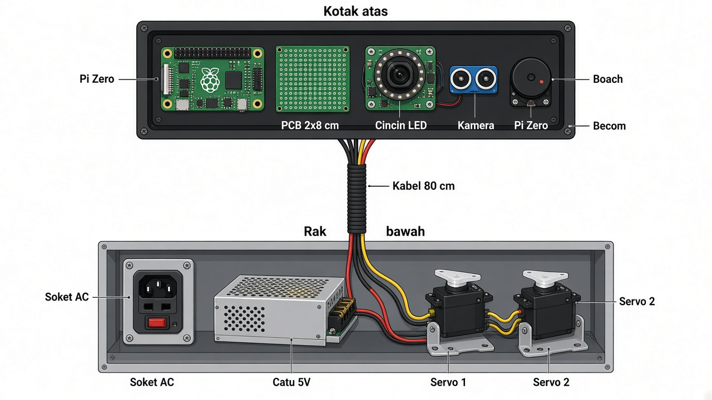
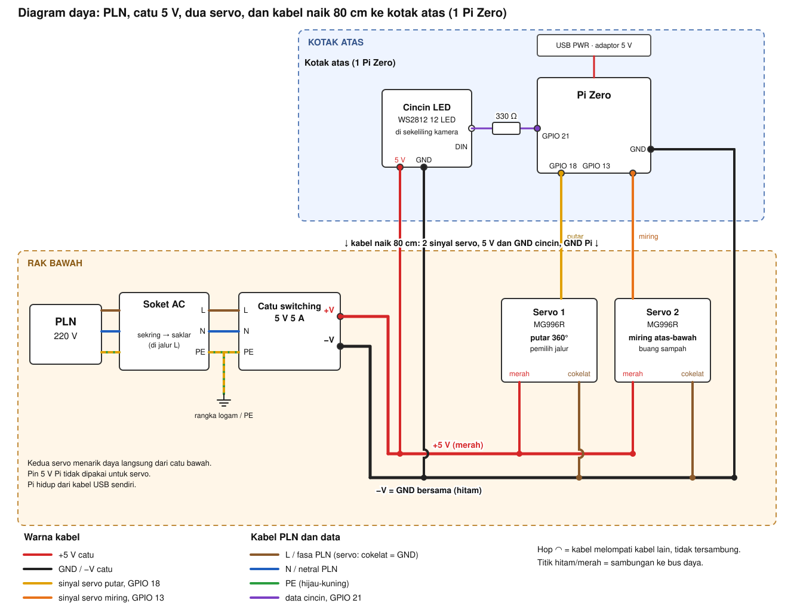
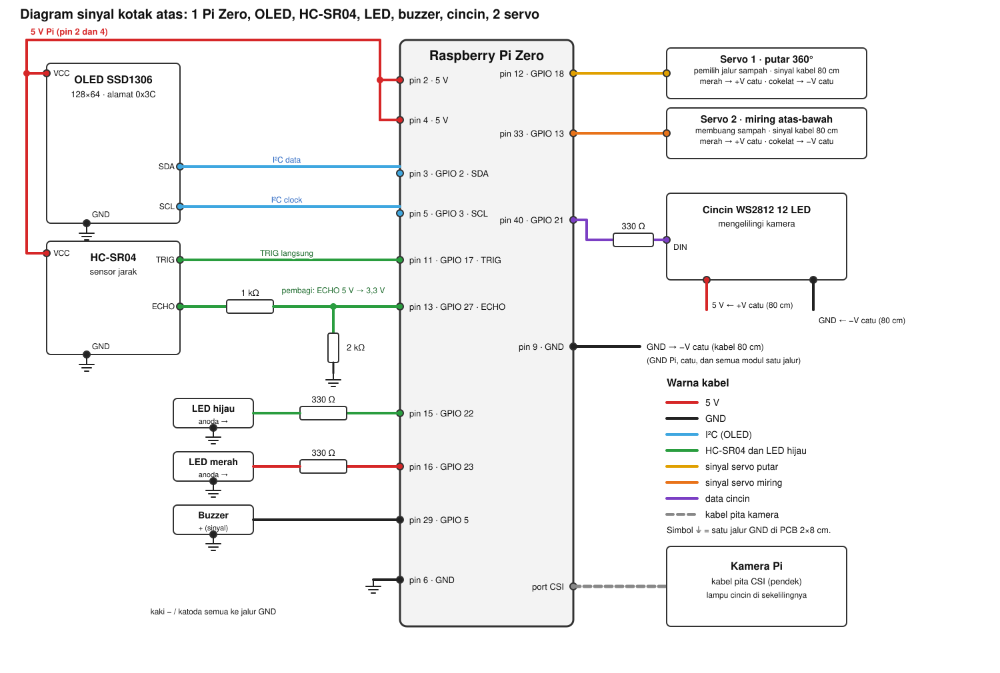
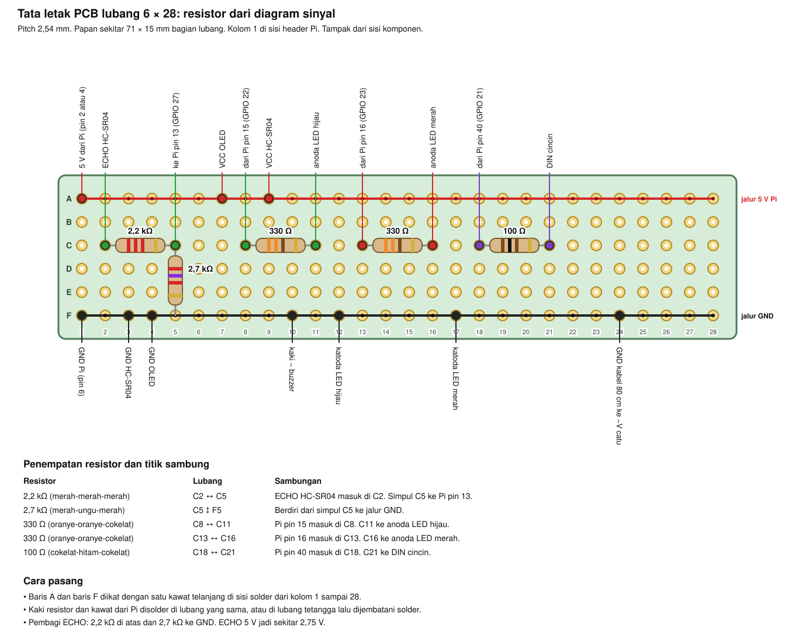

# Wiring Pi Zero

> Mekanik yang dikunci: [Rev G, flap kosong](3d/external-gears/CATATAN.txt).
> Pengendali stepper belum diaktifkan; wiring di bawah masih untuk konfigurasi servo.

Mesin punya dua tingkat. Kotak atas memegang elektronik yang dekat kamera. Rak bawah memegang listrik PLN, catu servo 6 V, dan dua servo.

Mesin memakai **satu Raspberry Pi Zero**. Servo yang rusak diganti **TD8120MG** (metal gear, 20 kg, gerak 180°). Servo MG996R yang masih hidup tetap di rel yang sama.

- **Servo 1** memilih jalur sampah (GPIO 18).
- **Servo 2** memiringkan flap ke atas dan ke bawah untuk membuang sampah (GPIO 13).

TD8120MG dipasang di posisi MG996R yang rusak. Kabel sinyal tidak pindah GPIO. Badan servo ini ukuran standar, braket MG996 biasanya masih muat; pakai horn yang ikut di kotak servo baru. Kabel dari Pi di atas ke servo dipotong **80 cm** (jalur terpakai sekitar 70 cm).



## Diagram rangkaian

Diagram daya: alur listrik PLN, catu servo 6 V 5 A, dua servo, dan kabel naik 80 cm ke kotak atas.



Diagram sinyal: sambungan tiap pin Pi Zero ke OLED, infrared E18-D80NK, LED, buzzer, dua servo, dan kamera. HC-SR04 dan cincin LED tidak dipasang.



Header 40 pin, urutan sama dengan pinout Pi Zero. Pin 1 adalah 3,3 V di ujung dekat kartu SD. Kabel oranye kedua servo masuk langsung, tanpa resistor.


## Rak bawah

Dari kiri ke kanan: soket AC, catu servo 6 V 5 A, lalu dua servo di tengah.

Catu yang dipakai adalah adaptor setel **UTech 5 A** (bodi yang lebih besar, kisaran 3–24 V). Unit 3 A jangan dipakai untuk dua servo. Kenop diputar sampai layar menunjukkan **6,0 V**, lalu diukur multimeter pada colokan sebelum kabel merah servo dipasang. Foto produk sering menampilkan 12 V atau 22 V; tegangan itu merusak servo. Setelah 6,0 V terbaca, kenop tidak diputar lagi.

Colokan barrel 5,5 mm, isi 2,1 mm atau 2,5 mm, **ujung tengah positif**. Selongsong luar adalah GND. Ujung positif ke kabel merah servo. Selongsong ke kabel cokelat servo dan ke GND Pi.

| Komponen | Dari | Ke |
| --- | --- | --- |
| Soket AC | L | sekring, lalu saklar, lalu L catu |
| Soket AC | N | N catu |
| Soket AC | PE | baut rangka logam, atau diisolasi jika kotak semua plastik |
| Catu 6,0 V 5 A | +V (ujung barrel) | kabel merah tiap servo |
| Catu 6,0 V 5 A | −V (selongsong) | kabel cokelat tiap servo dan GND Pi |
| Servo 1 (pemilih jalur) | sinyal | GPIO 18 / pin 12 pada Pi, kabel 80 cm |
| Servo 2 (miring atas-bawah) | sinyal | GPIO 13 / pin 33 pada Pi, kabel 80 cm |
| TD8120MG | merah / cokelat / oranye | sama seperti MG996R yang digantinya |

Kabel merah servo tidak masuk ke pin 5 V Pi. Pi tetap makan dari kabel USB-nya sendiri. OLED dan infrared tetap di 5 V pin Pi, bukan di catu 6 V ini.

TD8120MG dan MG996R sama-sama tahan 6,0 V. Pulsa sinyal tetap 50 Hz, 500 µs di satu ujung dan 2500 µs di ujung lain, jadi program sudut yang ada tidak diubah. TD8120MG hanya bergerak 180°, bukan berputar terus. Saat macet, satu servo 20 kg menarik sekitar 2–3 A. Catu 5 A cukup untuk satu servo macet dan satu servo bergerak. Jangan menahan kedua servo macet bersamaan.

## Kotak atas

Kotak plastik 160 × 130 × 45 mm. Isinya satu Pi Zero, kamera, infrared E18-D80NK, OLED, buzzer, LED hijau, LED merah, dan PCB lubang 2 × 8 cm. HC-SR04 dan cincin WS2812 tidak dipasang. GPIO 17 / pin 11 dan GPIO 21 / pin 40 dibiarkan kosong. Lampu satu LED di GPIO 24 tidak dipakai.

Pi Zero lebih besar dari PCB itu, jadi Pi tidak ditumpang di atas PCB. PCB memegang resistor, buzzer, LED indikator, dan header. Kamera, infrared, dan OLED dipasang di dinding kotak, lalu kawatnya masuk ke header PCB.

Infrared yang dipasang adalah tabung kuning **E18-D80NK**, muka ungu dengan dua jendela. Jarak diatur sekrup di belakang sampai lantai kosong tidak terdeteksi dan benda di atasnya terdeteksi. Keluaran NPN: kaki hitam LOW saat ada benda.

| Komponen | Dari | Ke |
| --- | --- | --- |
| OLED | VCC | 5 V Pi (pin 2) |
| OLED | GND | GND |
| OLED | SDA | GPIO 2 / pin 3 |
| OLED | SCL | GPIO 3 / pin 5 |
| E18-D80NK | cokelat (VCC) | 5 V Pi (pin 4) |
| E18-D80NK | biru (GND) | GND |
| E18-D80NK | hitam ke cokelat | 4,7 kΩ, sudah terpasang, ke 5 V Pi pin 4 |
| E18-D80NK | dari titik hitam | 1 kΩ menuju GPIO 27 / pin 13 |
| E18-D80NK | di kaki pin 13 | 10 kΩ turun ke GND |
| LED hijau | anoda | 330 Ω → GPIO 22 / pin 15 |
| LED merah | anoda | 330 Ω → GPIO 23 / pin 16 |
| Buzzer | sinyal | GPIO 5 / pin 29 |
| Servo 1 (pemilih jalur) | oranye, tanpa resistor | GPIO 18 / pin 12, kabel 80 cm turun |
| Servo 2 (miring atas-bawah) | oranye, tanpa resistor | GPIO 13 / pin 33, kabel 80 cm turun |
| TD8120MG dan MG996R | merah | +6,0 V catu rak bawah |
| TD8120MG dan MG996R | cokelat | −V catu rak bawah |

Kalau kabel sensor berwarna merah, hitam, dan kuning: merah = 5 V Pi, hitam = GND, kuning = OUT. OUT tetap lewat pembagi. Jangan menyambung VCC sensor ke catu servo.

Pin sinyal ada di `servo/pins.py`.

## Isi PCB 2 × 8 cm

Papan ini berbaring di dasar kotak, di samping Pi, sisi panjang 8 cm menghadap header Pi. Jangan menaruh Pi, kamera, badan infrared, atau modul OLED di atas papan. Bagian itu menempel di dinding kotak. Yang masuk ke lubang PCB hanya resistor, buzzer kecil, dan pin header.

Dua jalur disolder memanjang, tidak saling tersambung:

| Jalur | Isi | Tidak disambung ke |
| --- | --- | --- |
| GND | semua ground di kotak, termasuk GND Pi, GND infrared, dan GND kabel 80 cm dari catu bawah | — |
| 5 V Pi | VCC OLED dan VCC infrared, dari pin 2 atau pin 4 | catu servo |

Ground memang berkumpul di jalur GND pada PCB ini. Satu kawat dari situ ke pin GND Pi. Satu kawat 80 cm dari situ ke −V catu di bawah. Itulah sambungan ground bersama. Kabel merah servo tidak masuk ke papan ini.

Urutan dari kiri ke kanan pada papan:

1. Header dupont ke Pi.
2. Pull-up 4,7 kΩ dari jalur 5 V Pi ke kaki hitam infrared. Yang sudah terpasang dibiarkan.
3. Pembagi OUT: 1 kΩ lalu 10 kΩ. Ujung bawah 10 kΩ ke jalur GND.
4. Dua resistor 330 Ω untuk LED hijau dan LED merah. Katoda LED ke jalur GND.
5. Buzzer, kaki negatif ke jalur GND.
6. Di ujung kanan, header untuk kabel 80 cm: dua sinyal servo dan GND.

LED hijau, LED merah, dan buzzer boleh menempel di dinding kotak. Kakinya yang masuk ke PCB, bukan badannya, jika tempat di papan sudah penuh.

## Tata letak resistor di PCB lubang 6 × 28

Versi ini memakai papan dengan 6 baris (A sampai F) dan 28 kolom. Baris A jadi jalur 5 V Pi, baris F jadi jalur GND, semua resistor ada di baris C. Kabel merah servo datang langsung dari catu bawah dan tidak lewat papan ini.



| Resistor | Lubang | Sambungan |
| --- | --- | --- |
| 4,7 kΩ | A2 ↕ C2 | Sudah terpasang, dari 5 V Pi ke kaki hitam infrared |
| 1 kΩ | C2 ↔ C5 | Kaki hitam masuk di C2. Simpul C5 ke Pi pin 13 |
| 10 kΩ | C5 ↕ F5 | Dari simpul C5 ke jalur GND |
| 330 Ω | C8 ↔ C11 | Pi pin 15 masuk di C8. C11 ke anoda LED hijau |
| 330 Ω | C13 ↔ C16 | Pi pin 16 masuk di C13. C16 ke anoda LED merah |

Lubang C18 dan C21 kosong. Resistor 100 Ω cincin tidak dipasang.

Stok yang dibutuhkan: 4,7 kΩ yang sudah terpasang (kuning-ungu-merah), satu 1 kΩ (cokelat-hitam-merah-emas), satu 10 kΩ (biru, cokelat-hitam-hitam-merah), dan dua 330 Ω.

## Pembagi OUT infrared

Kaki hitam E18-D80NK naik mendekati 5 V saat kosong dan tertarik ke GND saat ada benda. GPIO hanya tahan 3,3 V.

```
5 V Pi ---- 4,7 kΩ ----+---- hitam (OUT)
                       |
                     1 kΩ
                       |
                       +---- GPIO 27 / pin 13
                       |
                    10 kΩ
                       |
                      GND
```

Saat kosong, tegangan ke GPIO sekitar 3,2 V. Saat ada benda, simpul itu mendekati 0 V. Jangan menyambung kaki hitam langsung ke pin 13.

## Kebutuhan kabel

Panjang di bawah sudah termasuk sedikit lebih untuk dilipat di ujung. Kabel 80 cm adalah jalur Pi di atas ke rak bawah.

### Di rak bawah, pendek

| Kabel | Jumlah | Panjang | Kawat | Sambungan |
| --- | --- | --- | --- | --- |
| Fasa | 1 | 15 cm | 0,75 mm² | L soket, lewat sekring dan saklar, ke L catu |
| Netral | 1 | 15 cm | 0,75 mm² | N soket ke N catu |
| Bumi | 1 | 15 cm | 0,75 mm² | PE soket ke rangka logam, atau diisolasi |
| 6 V servo | 2 | 20 cm | 0,75 mm² | +6,0 V catu ke merah tiap servo |
| GND servo | 2 | 20 cm | 0,75 mm² | −V catu ke cokelat tiap servo |

### Naik ke kotak atas

Satu Pi, satu set kabel.

| Kabel | Jumlah | Panjang | Kawat | Sambungan |
| --- | --- | --- | --- | --- |
| Sinyal servo 1 (putar) | 1 | 80 cm | 0,25 mm² | GPIO 18 ke kabel oranye/kuning servo 1 |
| Sinyal servo 2 (miring) | 1 | 80 cm | 0,25 mm² | GPIO 13 ke kabel oranye/kuning servo 2 |
| GND pasangan servo | 1 | 80 cm | 0,5 mm² | GND Pi ke −V catu, dipilin dengan kedua sinyal |

### Di dalam kotak, 15 cm

| Kabel | Jumlah per kotak | Kawat | Catatan |
| --- | --- | --- | --- |
| Dupont ke header Pi | 10 | 0,25 mm² | OLED, infrared, LED, buzzer, dua sinyal servo |
| Kabel pita kamera | 1 | pita CSI | dari kamera ke soket kamera Pi, pendek |
| Kabel infrared | 1 | 3 urat bawaan | cokelat ke pin 4, biru ke GND, hitam ke pembagi |

## Urutan pasang

1. Cabut PLN dan USB Pi.
2. Setel catu ke 6,0 V dan ukur dulu. Ikat servo di tengah rak bawah. Merah dan cokelat hanya ke catu 6 V. TD8120MG mengganti MG996R yang rusak di konektor yang sama.
3. Pasang soket AC. Fasa wajib lewat sekring dulu, baru saklar, baru ke catu. Tutup semua sambungan PLN sebelum kotak ditutup.
4. Naikkan dua sinyal servo dan GND sepanjang 80 cm. Jangan naikkan 6 V catu ke kotak atas.
5. Di kotak atas, solder pull-up dan pembagi kaki hitam, resistor LED, dan header pada PCB 2 × 8 cm. Baru kemudian colok ke Pi.
6. Nyalakan USB Pi dulu. Catu 6 V bawah dinyalakan setelah Pi hidup.
7. Hentikan program sebelum melepas kabel.

GPIO 17 dan GPIO 21 tidak disambung. Program masih membaca HC-SR04 sampai deteksi diganti ke kaki hitam infrared.
